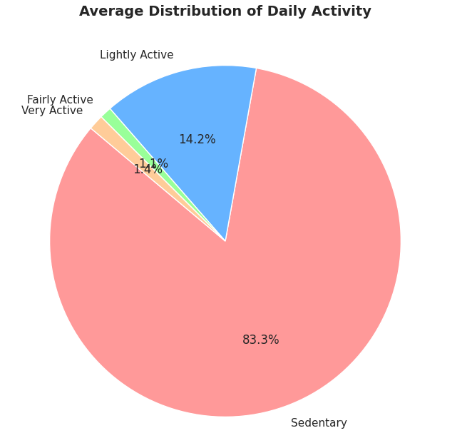
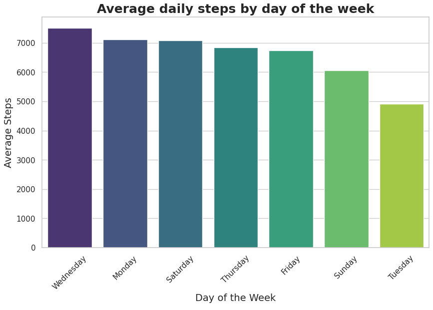
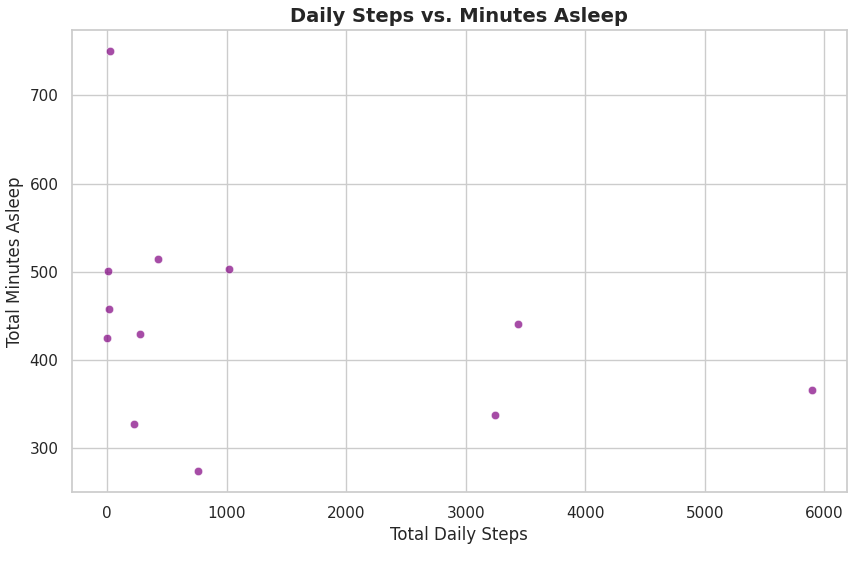
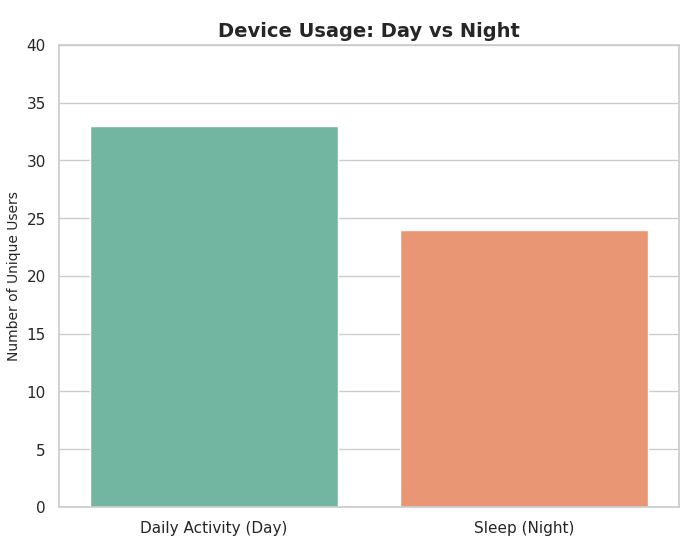

# Acitvity-Track-Data-Analysis-Python
A data analysis case study using Python (Pandas, Seaborn) to analyze smart fitness tracker data, uncover user behavior trends, and provide data-driven marketing recommendations for Bellabeat.

## Bellabeat Wellness Technology: Data Analysis Case Study

### Project Overview
Bellabeat is a high-tech manufacturer of health-focused smart products. I analyzed the smart device usage data in order to gain insight into how consumers use non-Bellabeat smart devices. The goal is to apply these insights to one Bellabeat product to guide future marketing strategies.

* **Role:** Junior Data Analyst
* **Tools Used:** Python (Pandas, Matplotlib, Seaborn)
* **Dataset:** Fitbit Fitness Tracker Data (Kaggle)

---

### The Business Task
The idea behind the task was to identify trends in how consumers use non-Bellabeat smart devices and apply those insights to Bellabeat's marketing strategy to unlock new growth opportunities for the company.Αlso those changes can apply
in order to help the company upgrade the smart health-devices they already have or even more to develop new ones in accordance with the requirements that resulting from the analysis.

---

### Key Data Insights & Visualizations

**1. The Sedentary Reality**
Users spend a vast majority of their day completely inactive, presenting a major opportunity for proactive wellness coaching. 

**2. The Mid-Week Activity Peak**
User activity peaks on Wednesdays and drops significantly by Sunday, showing a clear weekly cycle in motivation.

**3. Daily Steps vs. Sleep Relationship**
Analysis shows most users cluster around moderate steps and average sleep, with very few users hitting high daily step counts.

**4. The Device Drop-Off (Day vs. Night)**
While 33 unique users wear the device during the day, only 24 keep it on to track their sleep at night, revealing a significant gap in 24/7 tracking.

---

### Executive Recommendations

Based on the data analysis, here are the top three strategic recommendations for Bellabeat's marketing and product development teams:

**1. Combat Sedentary Lifestyles with Micro-Habits**
* **The Insight:** Users spend a vast majority of their tracked time completely sedentary.
* They also have very low average daily steps count (approximately 1,300 steps) when the suggested daily step count is 7,000-8,000 from World Health Organization (WHO).
* **The Strategy:** Position the Bellabeat app as a proactive wellness coach rather than just a passive tracking tool.
* **Actionable Step:** Implement a customizable "Time to Move" feature in the app, with notifications that encourage the users to make more steps. 
* Bellabeat can push marketing campaigns focused on "Micro-Habits," encouraging users to take short, 3-minute walking or stretching breaks. 

**2. Capitalize on Weekly Motivation Cycles**
* **The Insight:** User activity follows a distinct bell curve throughout the week.
* Activity peaks naturally on Wednesdays and drops significantly by Sunday.
* **The Strategy:** Use targeted notification campaigns to align with these natural user energy levels.
* **Actionable Step:** Launch "Mid-Week Push" notifications on Wednesday mornings to capitalize on peak motivation. 
* For the weekend slump, introduce relaxed, low-pressure app features like a "Sunday Stretch" routine or self-care checklist.
* This acknowledges that weekends might be for recovery rather than high-intensity steps.

**3. Address the Nighttime Tracking Gap (Device Retention)**
* **The Insight:** There is a noticeable drop-off in device usage from day to night. 
* While 33 users tracked daily activity, only 24 wore their devices to sleep.
* **The Strategy:** Turn this tracking gap into a competitive advantage by highlighting the physical design of Bellabeat products.
* **Actionable Step:** Launch a marketing campaign comparing the lightweight, jewelry-inspired design of the Bellabeat Leaf to the bulky nature of traditional smartwatches. 
* Educate users on the importance of sleep hygiene through the app, and that the monmitoring of sleep is important to improving quality of life.
* Emphasize that the Leaf is comfortable enough to wear 24/7 without disrupting rest.

---
**View the full Python code and data cleaning process in the attached .ipynb file.**
**https://www.kaggle.com/code/miltiadistzouvaras/bellabeat-analysis**
